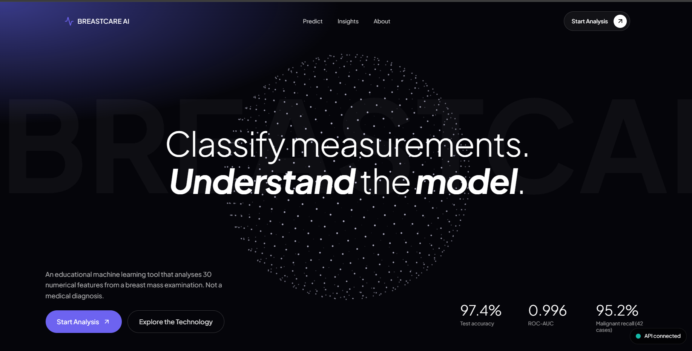
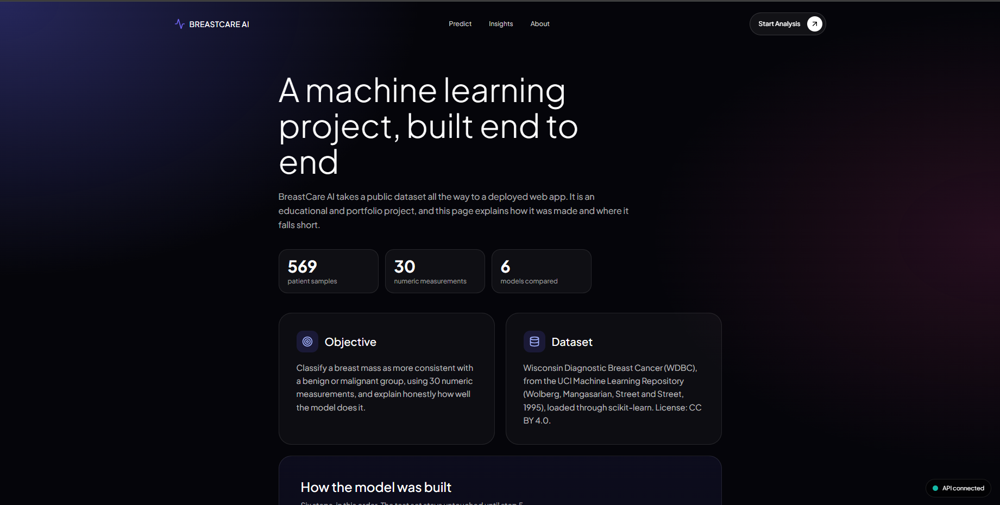
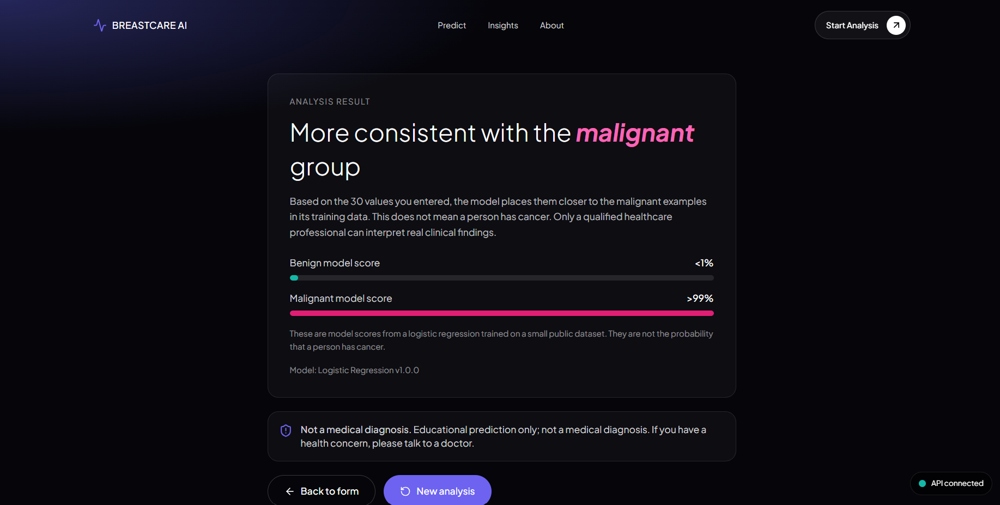
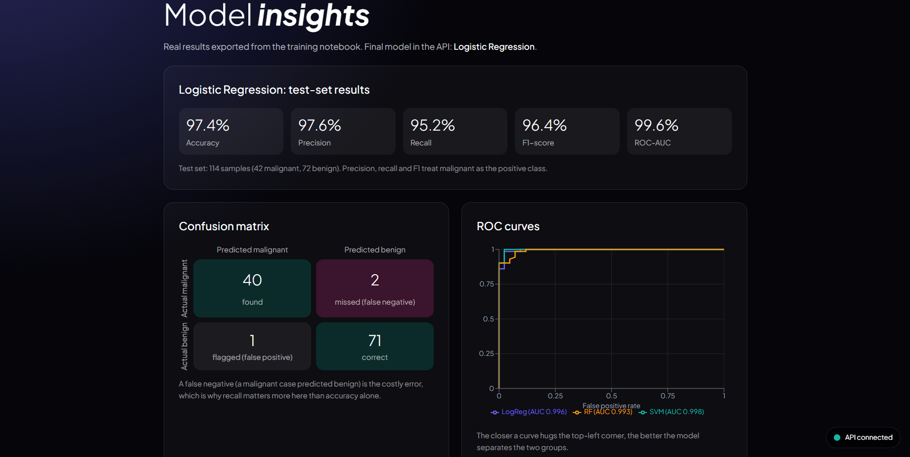

# Breast Cancer Classifier (BreastCare AI)

An educational machine learning project that classifies breast mass measurements as more consistent with a benign or malignant group. It covers the full workflow: data analysis, model training, a FastAPI backend, and a React frontend.

> **Disclaimer:** This is a portfolio project. It is not clinically validated and does not provide medical diagnoses. Please consult a qualified healthcare professional about any health concern.

## Live demo

**https://breast-cancer-classifier-theta.vercel.app/**

The backend runs on a free hosting plan. If nobody has used the app for a while, the first request can take about a minute while the server wakes up. If the status dot in the corner is red at first, wait a minute and refresh.

## Screenshots

| Home | Prediction form |
|---|---|
|  |  |

| Result | Insights |
|---|---|
|  |  |

## Dataset

Wisconsin Diagnostic Breast Cancer (WDBC) from the UCI Machine Learning Repository, loaded through scikit-learn. 569 samples and 30 numeric features computed from images of cell samples. License: CC BY 4.0.

## Model results (test set)

| Metric | Score |
|---|---|
| Accuracy | 97.4% |
| ROC-AUC | 0.996 |
| Malignant recall | 95.2% (42 malignant test cases) |

The test set was used once, after model selection. With only 42 malignant cases, one missed case changes recall by about 2.4 points.

## Tech stack

- **Machine learning:** Python, scikit-learn, pandas, NumPy, Jupyter, joblib
- **Backend:** FastAPI, Pydantic, Uvicorn, pytest
- **Frontend:** React, Vite, Tailwind CSS, React Router, Recharts
- **Hosting:** Render (backend), Vercel (frontend)

## Run it locally

Backend:

```
cd backend
python -m venv ../.venv
..\.venv\Scripts\Activate.ps1
pip install -r requirements.txt
uvicorn app.main:app --reload --port 8000
```

Frontend (in a second terminal):

```
cd frontend
npm install
npm run dev
```

Open http://localhost:5173

The frontend reads the API address from `VITE_API_BASE_URL` (default `http://127.0.0.1:8000`). The backend reads the allowed website list from `CORS_ORIGINS`.

## Limitations

- 569 samples from a single source, so the model may not generalize to other populations.
- Inputs are lab-derived image measurements that a person cannot measure at home.
- Model scores are not the probability that a person has cancer.

## Author

Chandra Narayan Panda